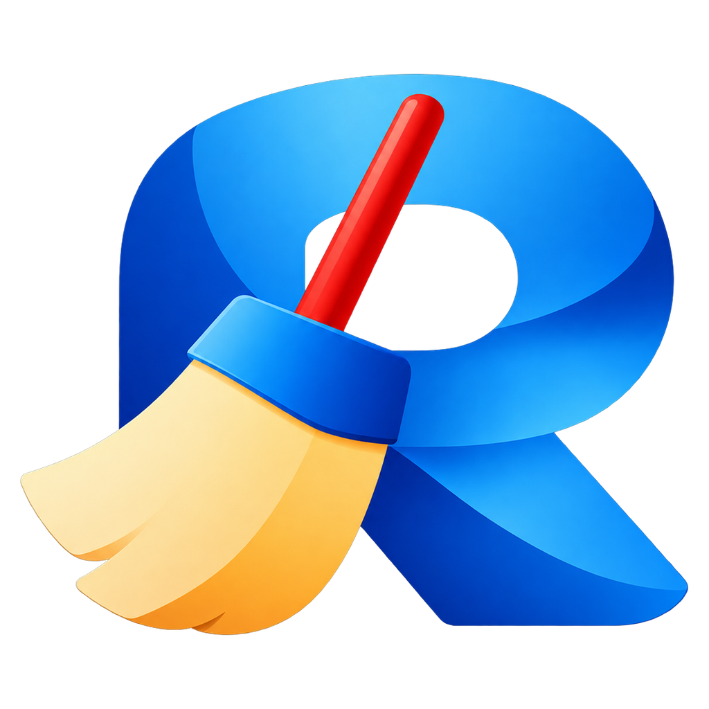

<div align="center">



# RCleaner

**Limpiador y herramienta de disco para Windows, modular y de código abierto, escrito en Rust.**

[English](README.md) · Español

</div>

RCleaner junta lo que normalmente necesita varias apps: un limpiador como
CCleaner o PC Manager, un mapa de disco como WinDirStat o DaisyDisk y un buscador
de duplicados. La limpieza se organiza en **modos**, así un gamer, un programador
y quien sólo quiere espacio libre tienen cada uno sus limpiadores.

> RCleaner es un guiño en broma a CCleaner: un proyecto independiente y de
> código abierto, sin relación ni respaldo de CCleaner ni de sus dueños. CCleaner
> es una marca registrada de su propietario.

> **Analizar nunca borra nada.** Cada hallazgo muestra su tamaño y su nivel de
> riesgo, y sólo los *Seguros* vienen marcados.

## Funciones

- **Resumen**: uso del disco del sistema, accesos directos y limpieza rápida.
- **Limpieza**: 37 limpiadores agrupados en modos (y los tuyos propios), aviso
  cuando hay abierta una app que bloquea sus archivos, exclusiones y reinicio
  como administrador para carpetas del sistema.
- **Espacio**: mapa radial navegable de cualquier unidad o carpeta, archivos más
  grandes y desglose por tipo. Lo que elijas va a la papelera.
- **Duplicados**: copias exactas por contenido (BLAKE3). Se saltan los enlaces
  duros y los archivos que sólo están en la nube, y siempre queda una copia.
- **Tu idioma y tu tema**: español e inglés (por defecto el del sistema), tema
  claro, oscuro o el del sistema. Se aceptan más idiomas, ver
  [Traducir](docs/TRANSLATING.es.md).
- **CLI**: el mismo motor desde la terminal (`rcl`).

### Modos

| Modo | Para quién | Qué limpia |
|---|---|---|
| **Rápido** | Cualquiera | Temporales, miniaturas, informes de errores, volcados, shaders, papelera, caché de navegadores |
| **Programador** | Devs | Rápido + pip/uv/poetry/conda, npm/pnpm/yarn/bun, Cargo, Go, Gradle, Maven, NuGet, VS Code/Cursor, JetBrains, `node_modules`/`target`/`__pycache__`/`.venv`, modelos de IA |
| **IA / ML** | Quien descarga modelos | Ollama, Hugging Face, LM Studio, Torch/Whisper/Keras + cachés de Python |
| **Gamer** | Juegos | Rápido + shaders (incluido Steam), Delivery Optimization, Windows Update |
| **Profundo** | Avanzado | Todos los módulos |

Riesgos: **Seguro** (se regenera solo, no pierdes nada), **Moderado** (se
regenera pero cuesta: descargas, re-indexado, recompilar) y **Avanzado** (datos
que pusiste ahí a propósito, como modelos o entornos virtuales). Lista completa
en [docs/MODULES.es.md](docs/MODULES.es.md).

## Instalar

Descarga el instalador más reciente (`…-setup.exe`, pregunta inglés o
español) o el exe portable desde la página de Releases. Funciona en Windows 10 y 11 sin internet ni descargas extra: el
instalador trae todo lo que necesita (ver [docs/BUILD.es.md](docs/BUILD.es.md#instaladores-autónomos)).

Tus ajustes están en `%APPDATA%\RCleaner\` (`settings.json`, `history.json`,
`modes\*.toml`).

## Compilar

```powershell
# Requisitos: Rust stable (MSVC), Node 20+, WebView2
cargo install tauri-cli --version "^2" --locked

git clone <url-del-repo> RCleaner; cd RCleaner
cargo test --workspace --exclude rcleaner         # tests del motor y módulos
cargo run -p crp-cli -- scan --mode programador    # vista previa en terminal

cd app; npm install
cargo tauri dev                                    # app con recarga en caliente
```

Instalador (NSIS) y exe portable: `.\scripts\build.ps1`. Más en
[docs/BUILD.es.md](docs/BUILD.es.md).

## CLI

```text
rcl info                              # rutas, admin, carpetas de proyectos detectadas
rcl modes                             # modos disponibles
rcl modules --mode programador        # módulos de un modo
rcl scan --mode programador           # vista previa agrupada
rcl scan --module "dev.*" --json      # selectores y salida JSON
rcl clean --mode rapido               # SIMULACIÓN de lo preseleccionado
rcl clean --mode rapido --yes         # limpia de verdad
rcl clean --mode programador --risk moderate --yes
rcl space C:\ --top 20                # qué ocupa espacio
rcl dupes D:\Fotos E:\Backup          # duplicados (no borra)
```

## Estructura

```
crates/
  crp-core/      motor: modelo, módulos, escaneo paralelo, borrado seguro, modos, idiomas
  crp-platform/  Win32 (admin, papelera, procesos, discos, idioma). Único sitio con unsafe
  crp-modules/   limpiadores: system, browsers, dev, ai
  crp-disk/      analizador de espacio y duplicados
  crp-cli/       binario `rcl`
app/
  src/           UI Svelte 5 + TypeScript
  src-tauri/     backend Tauri 2 (comandos, estado, bundle NSIS)
locales/         traducciones compartidas por la app, el motor y la CLI
docs/            roadmap, arquitectura, módulos, diseño, build, traducir
```

## Colaborar

Se aceptan reportes de errores, limpiadores nuevos, traducciones e ideas de
diseño. Empieza por [CONTRIBUTING.es.md](CONTRIBUTING.es.md); para añadir un
idioma, lee [docs/TRANSLATING.es.md](docs/TRANSLATING.es.md). Quien participe
debe seguir el [Código de conducta](CODE_OF_CONDUCT.es.md). Los problemas de
seguridad van por [SECURITY.md](SECURITY.md), no por issues públicos.

Hacia dónde vamos: [docs/ROADMAP.es.md](docs/ROADMAP.es.md).

## Licencia

[MIT](LICENSE)

Los iconos de carpetas de desarrollo vienen de
[Material Icon Theme](https://github.com/material-extensions/vscode-material-icon-theme)
(MIT, ver `app/src/assets/folders/`). El resto de iconos de archivos y apps se
leen de Windows en el PC del usuario; no se incluye ninguno.
