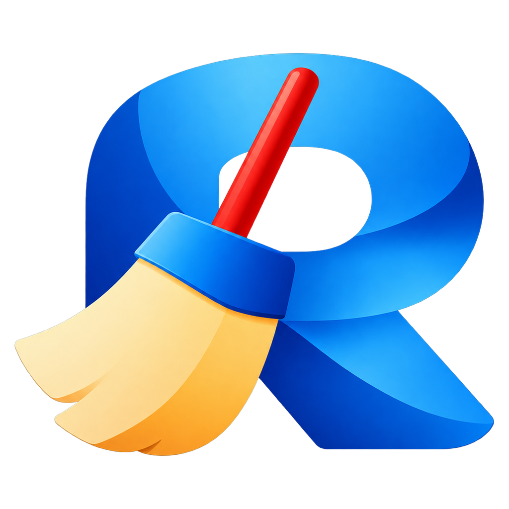

<div align="center">



# RCleaner

**A modular, open-source cleaner and disk tool for Windows, written in Rust.**

English · [Español](README.es.md)

</div>

RCleaner brings together what usually takes several apps: a cleaner like
CCleaner or PC Manager, a disk map like WinDirStat or DaisyDisk, and a duplicate
finder. Cleaning is organized in **modes**, so a gamer, a developer and someone
who just wants free space each get the right set of cleaners.

> RCleaner is a tongue-in-cheek nod to CCleaner: an independent open-source
> project, not affiliated with or endorsed by CCleaner or its owners. CCleaner is
> a trademark of its respective owner.

> **Analyzing never deletes anything.** Every finding shows its size and a risk
> level, and only the *Safe* ones are preselected.

## Is it safe?

Cleaners have earned a bad reputation: registry cleaners that break Windows,
browser data wiped by default, files gone without asking. RCleaner is built so
that can't happen to you, and every point below is enforced in the code (see
[Deletion safety](docs/ARCHITECTURE.md#deletion-safety)):

- **Analyzing never deletes anything.** Scanning only reads. You see every
  item, its size and its risk before anything happens, and you press the button.
- **Only what rebuilds itself is preselected.** Caches, temp files,
  thumbnails, error reports. Things that cost time (re-downloads) or are your
  data (AI models, cookies, history) are never marked for you — not even by
  "All".
- **A fixed list of known folders, no guessing.** Each cleaner targets the
  folders of one specific app or part of Windows. RCleaner never sweeps your
  disk for "junk" by pattern.
- **Hard limits in the engine.** Whatever a cleaner asks for, the engine
  refuses drive roots, your profile and its main folders (Documents, Desktop,
  Downloads, Pictures, Music, Videos, OneDrive), Program Files, ProgramData,
  the Windows folder and anything inside System32, SysWOW64, WinSxS, servicing
  or Boot.
- **Links are never followed.** A shortcut or junction inside a cache is
  removed as a link; what it points to is never touched.
- **Your exclusions always win.** Excluded folders are never analyzed or
  deleted, in any section.
- **Files in use are skipped**, never forced, and the app that holds them is
  named so you can close it.
- **What you pick by hand goes to the Recycle Bin** (Space and Duplicates),
  and Duplicates always keeps at least one copy.
- **Never:** registry "cleaning", Prefetch, "RAM boosters", saved passwords,
  bookmarks, form data or browser extensions. They bring no real benefit and
  are where most "it broke my PC" stories come from.
- **Startup changes are reversible.** Turning off a program, task or service
  deletes nothing (the same switch Task Manager uses).
- **Everything is logged.** A deletion log with path, size and date
  (Settings › Security).
- **Open source, no telemetry.** The only network request is the update
  check against this repository's releases (you can turn it off), and updates
  are signed.

**Honest limits:** cleaned caches and temp files are deleted for good (they
don't go to the Recycle Bin, since they rebuild on their own). Removing the
previous Windows installation or superseded updates can't be undone; those are
never preselected and say so. As with any tool, keep backups of what matters.

## Features

- **Overview** – how much you can free safely, a one-click quick clean and
  recommendations only when there's something to do (low disk space, a
  previous Windows installation, a full Recycle Bin, too many startup programs…).
- **Cleanup** – 40 cleaners grouped into modes (plus your own custom modes),
  warnings when an app that locks its files is open, exclusions and
  restart-as-administrator for system folders.
- **Space** – an interactive radial map of any drive or folder, the largest
  files and a breakdown by file type. Whatever you pick goes to the Recycle Bin.
- **Startup** – programs, scheduled tasks and third-party services that start
  with Windows; turn them off or on without deleting anything.
- **Duplicates** – exact copies by content (BLAKE3). Hard links and cloud-only
  files are skipped, and at least one copy of every file is always kept.
- **Your language and theme** – English and Spanish (the system language by
  default), light, dark or system theme. More languages are welcome, see
  [Translating](docs/TRANSLATING.md).
- **CLI** – the same engine from the terminal (`rcl`).

### Modes

| Mode | For | What it cleans |
|---|---|---|
| **Quick** | Anyone | Temp files, thumbnails, error reports, dumps, shaders, Recycle Bin, browser caches |
| **Developer** | Devs | Quick + pip/uv/poetry/conda, npm/pnpm/yarn/bun, Cargo, Go, Gradle, Maven, NuGet, VS Code/Cursor, JetBrains, `node_modules`/`target`/`__pycache__`/`.venv`, AI models |
| **AI / ML** | Model hoarders | Ollama, Hugging Face, LM Studio, Torch/Whisper/Keras + Python caches |
| **Gamer** | Games | Quick + shaders (including Steam), Delivery Optimization, Windows Update |
| **Deep** | Advanced | Every module |

Risk levels: **Safe** (rebuilt automatically, nothing of yours is lost),
**Moderate** (rebuilt but costs time: re-downloads, re-indexing, rebuilds) and
**Advanced** (data you put there on purpose, like models or virtual
environments). The full list is in [docs/MODULES.md](docs/MODULES.md).

## Install

Download the latest installer (`…-setup.exe`, asks for English or Spanish)
or the portable exe from the Releases page.
Works on Windows 10 and 11 without internet or extra downloads: the installer
brings everything it needs (see [docs/BUILD.md](docs/BUILD.md#self-contained-installers)).

Your settings live in `%APPDATA%\RCleaner\` (`settings.json`, `history.json`,
`modes\*.toml`).

## Build from source

```powershell
# Requirements: Rust stable (MSVC), Node 20+, WebView2
cargo install tauri-cli --version "^2" --locked

git clone <repo-url> RCleaner; cd RCleaner
cargo test --workspace --exclude rcleaner         # engine and module tests
cargo run -p crp-cli -- scan --mode programador    # preview in the terminal

cd app; npm install
cargo tauri dev                                    # desktop app with hot reload
```

Installer (NSIS) and portable exe: `.\scripts\build.ps1`. More in
[docs/BUILD.md](docs/BUILD.md).

## CLI

```text
rcl info                              # paths, admin, detected project folders
rcl modes                             # available modes
rcl modules --mode programador        # modules of a mode
rcl scan --mode programador           # grouped preview
rcl scan --module "dev.*" --json      # selectors and JSON output
rcl clean --mode rapido               # DRY RUN of the preselected items
rcl clean --mode rapido --yes         # really clean
rcl clean --mode programador --risk moderate --yes
rcl space C:\ --top 20                # what takes up space
rcl dupes D:\Photos E:\Backup         # duplicates (deletes nothing)
```

Mode ids (`rapido`, `programador`, `ia`, `gamer`, `profundo`) are stable
identifiers; their names are translated.

## Project layout

```
crates/
  crp-core/      engine: model, modules, parallel scan, safe deletion, modes, i18n
  crp-platform/  Win32 (admin, Recycle Bin, processes, drives, language). The only unsafe code
  crp-modules/   cleaners: system, browsers, dev, ai
  crp-disk/      space analyzer and duplicate finder
  crp-cli/       the `rcl` binary
app/
  src/           Svelte 5 + TypeScript UI
  src-tauri/     Tauri 2 backend (commands, state, NSIS bundle)
locales/         translations shared by the app, the engine and the CLI
docs/            roadmap, architecture, modules, design, build, translating
```

## Contributing

Bug reports, new cleaners, translations and design ideas are all welcome.
Start with [CONTRIBUTING.md](CONTRIBUTING.md); to add a language, read
[docs/TRANSLATING.md](docs/TRANSLATING.md). Everyone taking part is expected to
follow the [Code of Conduct](CODE_OF_CONDUCT.md). Security issues go through
[SECURITY.md](SECURITY.md), not public issues.

Where things are going: [docs/ROADMAP.md](docs/ROADMAP.md).

## License

[MIT](LICENSE)

Folder icons for development folders come from
[Material Icon Theme](https://github.com/material-extensions/vscode-material-icon-theme)
(MIT, see `app/src/assets/folders/`). All other file and app icons are read
from Windows on the user's PC; none are bundled.
